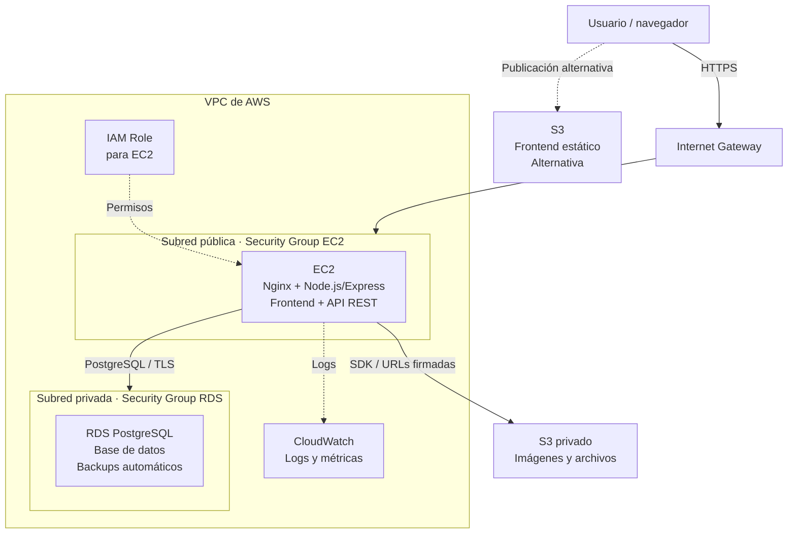
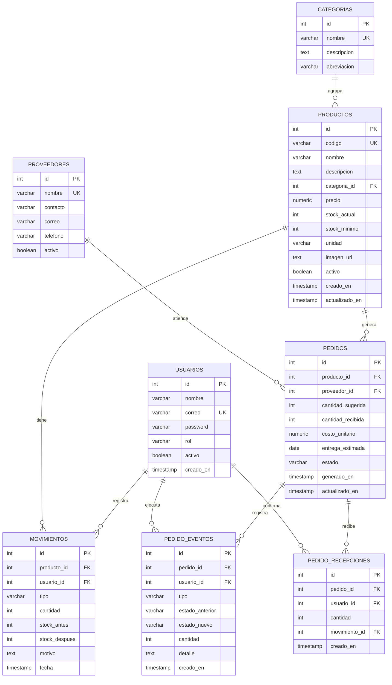

# Arquitectura y modelo de datos

## Diagrama de arquitectura

### Flujo principal

1. El navegador llega por HTTPS a través del Internet Gateway.
2. EC2 se encuentra en la subred pública y ejecuta Nginx, Node.js y Express.
3. Nginx entrega el frontend y redirige las rutas de API a Node.js/Express.
4. Node.js/Express valida JWT y roles antes de ejecutar la operación.
5. La API consulta o actualiza PostgreSQL en RDS mediante TLS.
6. RDS está en una subred privada y solo acepta conexiones desde EC2.
7. Las imágenes de productos se almacenan en S3 y la API entrega URLs firmadas.
8. CloudWatch recibe logs y métricas; IAM autoriza el acceso de EC2 a S3.

## Modelo de datos

### Reglas principales

- `usuarios.rol`: `administrador`, `bodega` o `cajero`.
- `movimientos.tipo`: `entrada`, `salida` o `ajuste`.
- `pedidos.estado`: `pendiente`, `enviado`, `recibido` o `cancelado`.
- Un producto pertenece opcionalmente a una categoría.
- Cada movimiento identifica el producto afectado y el usuario responsable.
- Cuando el stock llega al mínimo configurado, se puede generar un pedido sugerido.
- Un pedido puede asociarse con un proveedor, costo, fecha estimada y recepciones parciales.
- `pedido_eventos` conserva el historial de cambios de estado del pedido.
- `pedido_recepciones` relaciona cada recepción con el movimiento de inventario generado.

Fuentes: [migrate.js](../src/db/migrate.js), [upgrade-pedidos.js](../src/db/upgrade-pedidos.js), [pedidos.service.js](../src/services/pedidos.service.js) y las rutas de compras.
